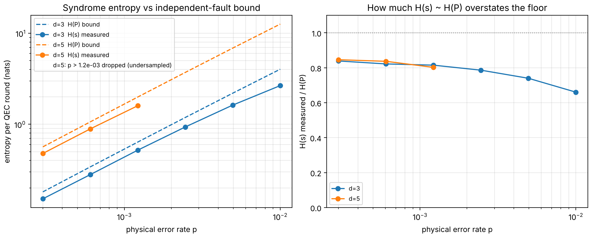

# thermodynamic-cost-of-information-processing-in-quantum-circuits
A working draft for a paper applying Lindblad GKSL dynamics and quantum relative entropy to derive thermodynamic lower bounds for quantum circuits.

## a quick matplotlib graph from the code 

## ai usage

this is the first repo where I used generative AI to create me a flowchart of the project for new researchers, I am lowk sad that I had to use it as there were my exams and allat shi jus dont flame me ong
