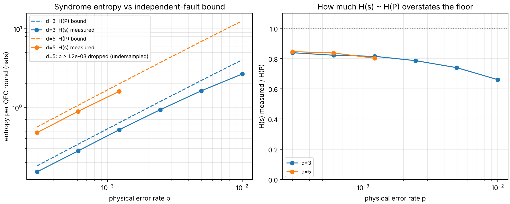

# thermodynamic-cost-of-information-processing-in-quantum-circuits
A working draft for a paper applying Lindblad GKSL dynamics and quantum relative entropy to derive thermodynamic lower bounds for quantum circuits.

## a quick matplotlib graph from the code 

