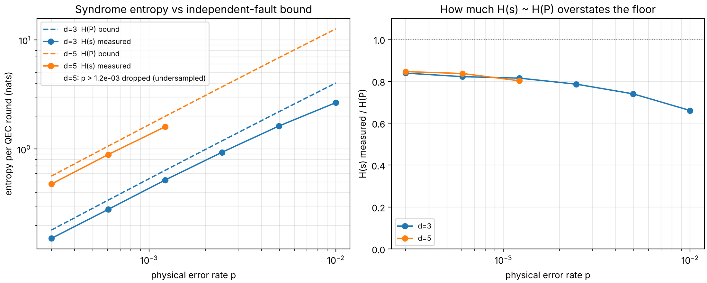

# Thermodynamic Cost of Information Processing in Quantum Circuits

### Lindblad Bounds on Gates, Error Correction, and Fault-Tolerant Depth

**kds1123** — Working draft, 8 November 2026

---

## Abstract

We derive thermodynamic lower bounds on the cost of running quantum circuits using only Lindblad (GKSL) dynamics, the quantum relative entropy, and the second law in entropy-production form. The main results are as follows. (i) A local second law: for a circuit implemented by a time-dependent Lindbladian with locally detailed-balanced dissipators, entropy production is a sum of non-negative terms, one per dissipative channel, so every fault location and every reset carries its own bound. (ii) Without error correction, the relative entropy to the maximally mixed state contracts exponentially in depth, so noisy circuits lose all information after depth $O(\log N/\gamma\tau)$. (iii) Any error-correction round must export at least $kT\,H(s)$ of heat, where $H(s)$ is the Shannon entropy of the syndrome distribution. This yields a hashing-type entropic bound on tolerable noise ($\approx 18.9\%$ depolarizing at zero rate), a thermal-threshold condition $T \le \hbar\omega/[k\ln(1/\varepsilon_{\rm th}-1)]$ on the reset bath, and a depth law $Q_{\min}\propto N_L D_L\, d^3 s(p)$ with $d=\Theta(\log(N_L D_L))$ for surface-code fault tolerance. (iv) Numerically, a circuit-level simulation shows that the measured syndrome entropy is about 80% of the independent-fault bound at $d=3$ and $d=5$, and the resulting Landauer estimate for a million-logical-qubit machine is of order 100 nanowatts at the wall plug, many orders of magnitude below any engineering estimate. The binding constraints are entropy throughput and reset fidelity, not Landauer heat.

---

## 1. Introduction

Discussions of the thermodynamics of computation often stop at the observation that erasing a bit costs $kT\ln 2$. For quantum circuits this is too coarse in three ways. First, ideal unitary gates are logically reversible and carry no Landauer cost, so all irreversibility sits in noise, measurement, and reset. Second, error correction converts noise entropy into syndrome entropy that must be physically removed every round, so the cost scales with the number of fault locations, not the number of logical operations. Third, fault-tolerance thresholds are statements about noise strength, and at fixed level spacing noise strength is a statement about temperature; thresholds therefore translate into temperature and entropy-flux constraints.

The contributions are:

1. A local form of the second law for Lindbladian circuits (Theorem 1) and the resulting Landauer, free-energy, and finite-time bounds (Propositions 1–4).
2. An entropy–error tradeoff for bath-assisted operations (Proposition 5).
3. A depth limit for noisy circuits without error correction, expressed as relative-entropy contraction (Proposition 6).
4. A syndrome-entropy Landauer bound for error-correction rounds, a hashing-type entropic bound on noise, and a thermal threshold condition (Theorem 2, Corollary 1, Propositions 7–8).
5. A scaling law for the minimum dissipation of fault-tolerant computation in circuit depth and width, with a numerical estimate and a circuit-level numerical check of the approximation $H(s)\approx H(P)$ (Theorem 3, Section 7.1).

Entropies are in nats, $k_B$ is written explicitly where energies appear, and $S(\rho)=-\mathrm{Tr}\,\rho\ln\rho$.

---

## 2. Framework

### 2.1 Lindblad dynamics

Consider $N$ qubits with a controlled system Hamiltonian $H_S(t)$. The state evolves as

$$
\dot\rho = -i[H_S(t),\rho] + \sum_k \mathcal{D}_{k,t}(\rho),
$$

$$
\mathcal{D}_{k,t}(\rho) = \sum_j \gamma_{kj}\Big(L_{kj}\rho L_{kj}^\dagger - \tfrac12\{L_{kj}^\dagger L_{kj},\rho\}\Big).
$$

We assume:

- **(A1)** Markovian GKSL form, so each $e^{s\mathcal{D}_{k,t}}$ is completely positive and trace preserving.
- **(A2)** Local detailed balance: each $\mathcal{D}_{k,t}$ has a stationary state $\sigma_k(t)$. For a thermal bath at inverse temperature $\beta_k$, $\sigma_k(t)=e^{-\beta_k H_S(t)}/Z_k(t)$; for unital noise (depolarizing, dephasing) $\sigma_k=I/2^N$.
- **(A3)** Gate times are long compared with the bath correlation time, which justifies using the instantaneous Hamiltonian in the dissipator. Outside this regime the master equation is not internally consistent (Alicki–Lidar–Zanardi [25]), and the bounds should be read in the system-plus-bath unitary picture of Section 3.

The heat current into the system from bath $k$ is $\dot Q_k=\mathrm{Tr}[H_S\,\mathcal{D}_k(\rho)]$.

### 2.2 Relative entropy and entropy production

The quantum relative entropy $S(\rho\|\sigma)=\mathrm{Tr}\,\rho(\ln\rho-\ln\sigma)$ is non-negative, unitarily invariant, jointly convex, and monotone under CPTP maps. Define the entropy production rate

$$
\dot\Sigma=\frac{dS}{dt}-\sum_k\beta_k\dot Q_k .
$$

**Theorem 1 (Local second law).** Under (A1)–(A2),

$$
\dot\Sigma=\sum_k\dot\sigma_k,\qquad \dot\sigma_k=-\mathrm{Tr}\!\big[\mathcal{D}_k(\rho)\big(\ln\rho-\ln\sigma_k\big)\big]\ \ge 0 .
$$

*Proof.* The Hamiltonian part does not change the von Neumann entropy, so $dS/dt=-\mathrm{Tr}[\sum_k\mathcal{D}_k(\rho)\ln\rho]$. For thermal $\sigma_k$, $\ln\sigma_k=-\beta_kH_S-\ln Z_k$ and $\mathrm{Tr}\,\mathcal{D}_k(\rho)=0$, so $-\beta_k\dot Q_k=\mathrm{Tr}[\mathcal{D}_k(\rho)\ln\sigma_k]$. Summing gives the stated form. For non-negativity, $e^{s\mathcal{D}_k}$ is CPTP with fixed point $\sigma_k$, so $s\mapsto S(e^{s\mathcal{D}_k}\rho\|\sigma_k)$ is non-increasing for $s\ge0$. Its derivative at $s=0$ is $\mathrm{Tr}[\mathcal{D}_k(\rho)(\ln\rho-\ln\sigma_k)]$, hence $\dot\sigma_k\ge0$. $\square$

The consequence used throughout is additivity: total entropy production of a circuit is a sum over gate locations, idle periods, measurements, and resets, each separately non-negative. Any subset of terms is therefore a valid lower bound on the total.

---

## 3. Generalized Landauer Bounds

**Proposition 1 (Lindblad–Landauer).** Let $Q^b_k=-\int\dot Q_k\,dt$ be the heat delivered to bath $k$ over a protocol taking $\rho$ to $\rho'$. Then

$$
\sum_k\beta_kQ^b_k=\Sigma-\Delta S\ \ge\ S(\rho)-S(\rho'),
$$

with equality iff every $\dot\sigma_k$ vanishes along the trajectory (quasi-static operation). The bound applies to any logically irreversible map, including discarding ancillas, not only bit erasure.

**Proposition 2 (Exact form beyond Lindblad).** Let system $A$ be coupled by a global unitary to a bath $B$ initially thermal at $\beta$ and uncorrelated with $A$. Then (Reeb–Wolf [12], rearranged)

$$
\beta Q=S(\rho_A)-S(\rho_A')+I(A':B')+S(\rho_{B'}\|\tau_B),
$$

where $Q$ is the heat absorbed by $B$, $I$ is the post-interaction mutual information, $\rho_{B'}$ is the final state of the bath, and $\tau_B$ is the initial thermal state. Every term beyond the first is non-negative, so $\beta Q\ge S(\rho_A)-S(\rho_A')$ with no weak-coupling or Markov assumption.

**Proposition 3 (Free-energy ledger).** Define $F_{\rm neq}(\rho,H)=\mathrm{Tr}\,\rho H-kT\,S(\rho)=F_{\rm eq}(H)+kT\,S(\rho\|\gamma_H)$, with $\gamma_H$ the Gibbs state. For a protocol with work $W$ and $H_0\to H_\tau$, integrating Theorem 1 gives

$$
\beta W=\beta\Delta F_{\rm eq}+\big[S(\rho_\tau\|\gamma_\tau)-S(\rho_0\|\gamma_0)\big]+\Sigma .
$$

For a thermal initial state the dissipated work obeys $\beta W_{\rm diss}\ge S(\rho_\tau\|\gamma_\tau)$.

**Proposition 4 (Finite-time Landauer).** In the slow-driving regime $\Sigma=\int\dot\lambda^{\top}\zeta(\lambda)\dot\lambda\,dt$, with $\zeta$ a positive semi-definite friction tensor proportional to the bath relaxation time. By Cauchy–Schwarz,

$$
\Sigma\ \ge\ \frac{\mathcal{L}^2}{\tau},\qquad \mathcal{L}=\int\sqrt{\dot\lambda^{\top}\zeta\,\dot\lambda}\;dt,
$$

where $\mathcal{L}$ is the thermodynamic length [11, 14]. Combined with Proposition 1,

$$
Q^b\ \ge\ kT\big[S(\rho)-S(\rho')\big]+kT\,\frac{\mathcal{L}^2}{\tau}.
$$

**Remark (Single-shot costs).** The von Neumann bounds are the typical, asymptotic limit. For a single error-correction round on a small block, costs are governed by smoothed max-relative-entropy quantities [17, 13], which for the ancilla states used below exceed the von Neumann values by terms of the order of the standard deviation of $-\ln p(s)$.

---

## 4. Gate Operations

### 4.1 Coherent gates

An ideal unitary $U$ has $\Delta S=0$, hence zero Landauer cost (Bennett [2]). The unavoidable costs are elsewhere. The control field that implements $U$ carries finite energy, and conservation-law arguments (Ozawa [31]; Gea-Banacloche [32]) bound the gate error from below by a term scaling as $1/\bar n$ in the mean excitation number of the control, so control energy per gate scales as $E_c\gtrsim\hbar\omega/\varepsilon$ for target error $\varepsilon$, with a model-dependent prefactor. Generation and distribution of the control signal is classical and lies outside the Lindbladian.

### 4.2 Noisy gates

Let a gate be followed by a Pauli channel with error distribution $P$. Since the output is a mixture of the states $E\rho E^\dagger$,

$$
S(\mathcal{N}(\rho))-S(\rho)\le H(P),
$$

with equality iff the error-displaced states are mutually orthogonal. For per-qubit depolarizing error of total probability $p$, $H(P)=s(p):=h(p)+p\ln3$ per fault location, with $h$ the binary entropy in nats. For small $p$,

$$
s(p)\approx p\ln(1/p)+p(1+\ln 3).
$$

For a two-qubit depolarizing fault of total probability $p$ (15 non-identity Paulis) the entropy per location is $h(p)+p\ln15$, and measurement and reset faults are classical bit flips contributing $h(p)$ each.

### 4.3 Entropy–error tradeoff for bath-assisted operations

Operations that use a bath actively (reset, thermalization-based gates, autonomous stabilization) are subject to Proposition 4. Their error has a decoherence floor $\varepsilon\ge\gamma_{\rm err}\tau$.

**Proposition 5.** For slow-driven, bath-assisted operations with $\varepsilon\ge\gamma_{\rm err}\tau$,

$$
\Sigma\cdot\varepsilon\ \ge\ \gamma_{\rm err}\,\mathcal{L}^2 .
$$

*Proof.* $\Sigma\ge\mathcal{L}^2/\tau$ and $\tau\le\varepsilon/\gamma_{\rm err}$ give $\Sigma\ge\mathcal{L}^2\gamma_{\rm err}/\varepsilon$. $\square$

Slower operation lowers dissipation and raises error, and the product has a geometric lower bound. If the same bath sets both the friction and the error rate, the product is bounded by an $O(1)$ constant in units of the squared thermodynamic distance; this is a scaling heuristic, since the two timescales are generally set by different environments. Coherent gates of superconducting or ion-trap qubits are fast compared with relaxation and are not described by Proposition 4.

### 4.4 Reset at finite temperature

Resetting an ancilla with level spacing $\hbar\omega$ by contact with a bath at $T_c$ cannot produce a pure state. Full thermalization leaves a residual excited population

$$
\varepsilon_r=\frac{1}{1+e^{\hbar\omega/kT_c}} .
$$

The Landauer price of going from the maximally mixed state to this state is $kT_c[\ln2-h(\varepsilon_r)]\le kT_c\ln2$. Achieving $\varepsilon_r\le\varepsilon$ requires $T_c\le\hbar\omega/(k\ln(1/\varepsilon-1))$, and reaching $\varepsilon\to0$ with finite resources is forbidden by the third law [29]. Reset infidelity therefore enters the error budget as a fault location of its own, and its price is paid in refrigeration (Section 7).

---

## 5. Depth Limits Without Error Correction

Take an $N$-qubit circuit of $D$ layers, each a unitary $U_\ell$ followed by single-qubit depolarizing noise for time $\tau$, generated by

$$
\mathcal{L}_{\rm dep}(\rho)=\gamma\sum_i\big(\mathrm{Tr}_i(\rho)\otimes I_i/2-\rho\big).
$$

The fixed point $I/2^N$ is unitarily invariant, so by Theorem 1 the quantity $D_\ell:=S(\rho_\ell\|I/2^N)=N\ln2-S(\rho_\ell)$ is unchanged by the unitaries and non-increasing under noise.

**Proposition 6.** Assume the depolarizing semigroup satisfies a modified log-Sobolev inequality with a constant $\alpha>0$ independent of $N$, in the normalization $-\mathrm{Tr}[\mathcal{L}_{\rm dep}(\rho)(\ln\rho-\ln(I/2^N))]\ge2\alpha\gamma\,S(\rho\|I/2^N)$. Then

$$
D_\ell\le e^{-2\alpha\gamma\tau}D_{\ell-1},\qquad D_D\le N\ln2\cdot e^{-2\alpha\gamma\tau D},
$$

and the entropy produced in layer $\ell$ is exactly $\Delta S_\ell=D_{\ell-1}-D_\ell\le(1-e^{-2\alpha\gamma\tau})D_{\ell-1}$. By Pinsker's inequality, the output is within trace distance $\eta$ of the maximally mixed state once

$$
D\ \ge\ D^*=\frac{\ln\!\big(N\ln2/(2\eta^2)\big)}{2\alpha\gamma\tau}.
$$

The existence of an $N$-independent constant is the content of the log-Sobolev results of Kastoryano–Temme [26] and Müller-Hermes–Stilck França–Wolf [27]; the application to noisy circuits is due to Stilck França and García-Patrón [28], and the qualitative $O(\log N)$ depth limit for unital noise without fresh ancillas is the Aharonov–Ben-Or–Impagliazzo–Nisan theorem [19]. The contraction is stated in the form needed here; no claim of optimal constant is made.

The thermodynamic reading is direct: entropy production per layer decays like $e^{-2\alpha\gamma\tau\ell}$, because noise can only destroy information still present. Beyond depth $D^*$ the circuit is thermodynamically quiet only because the computation is gone. Because unital noise has an infinite-temperature fixed point, there is no heat flow in this setting: $\Sigma$ here counts information loss, not an energy cost, and the result is a restatement, in the language of entropy production, of the depth limits of [28] and [19]. Non-unital noise (amplitude damping toward a Gibbs state) has a different fixed point and can lower entropy, the loophole that error correction with cold ancillas exploits [24].

---

## 6. Thermodynamics of Quantum Error Correction

### 6.1 Setup

Take an $[[n,k,d]]$ stabilizer code and a round consisting of: Pauli noise with error distribution $P$ on the data block; ideal syndrome extraction by a unitary $V$ coupling data to $m=n-k$ ancillas initialized in $|0\rangle$; recovery controlled on the ancillas; and reset of the ancillas to $|0\rangle$ by contact with a thermal bath at $T_c$. Let $s(E)$ be the syndrome of error $E$ and $p(s)$ its distribution.

**Theorem 2 (Syndrome-entropy Landauer bound).** Let $\varepsilon_r$ be the residual excited population of each ancilla after reset (Section 4.4; $\varepsilon_r=0$ for an ideal reset). The heat delivered to the reset bath per round satisfies

$$
Q_c\ \ge\ kT_c\,\big[H(s)-m\,h(\varepsilon_r)\big],\qquad H(s)=-\sum_sp(s)\ln p(s)=H(P)-H(E\,|\,s).
$$

For an ideal reset this reduces to $Q_c\ge kT_c\,H(s)$.

*Proof.* After $V$, the global state is $\sum_s|s\rangle\langle s|_A\otimes\big(\sum_{E:s(E)=s}P(E)\,E\rho_LE^\dagger\big)$, because the Pauli channel is a classical mixture of unitaries and distinct syndromes occupy orthogonal ancilla states. The ancilla marginal is $\rho_A=\sum_sp(s)|s\rangle\langle s|$ with $S(\rho_A)=H(s)$. The bath is initially thermal and uncorrelated with $A$. The reset leaves each ancilla in the thermal state with excited population $\varepsilon_r$, so the final ancilla state has entropy $S(\rho_A')=m\,h(\varepsilon_r)$, which is zero for an ideal reset. Proposition 2 then gives $\beta Q_c\ge H(s)-m\,h(\varepsilon_r)$. The identity $H(P)=H(s)+H(E|s)$ holds because $s$ is a function of $E$. $\square$

**Remark (finite-temperature reset).** The correction $m\,h(\varepsilon_r)$ is negligible at the temperatures used in Section 7 and large at the thermal-threshold edge. For a 5 GHz qubit at $T_c=20$ mK, $\varepsilon_r\approx6\times10^{-6}$ and $m\,h(\varepsilon_r)\approx0.02$ nats for $m=288$ ancillas ($d=17$). At $\varepsilon_r=1\%$, $h(\varepsilon_r)\approx0.056$ nats and the same register has $m\,h(\varepsilon_r)\approx16$ nats, which is comparable to the syndrome entropy per round estimated in Section 7 and removes most of the bound. Reset fidelity is therefore a real constraint on the lower bound itself, not only on the error budget.

Two bounds on $H(s)$ follow: $H(s)\le H(P)$ and $H(s)\le m\ln2$. For a non-degenerate code that corrects all typical errors, $H(E|s)\approx0$ and $H(s)\approx H(P)$: the entropy injected by noise is exactly the entropy exported. For degenerate codes $H(s)<H(P)$. The classical record of the syndrome, if stored and later erased, costs the same $kT\,H(s)$ and must not be counted twice. The Lindblad accounting splits the round's entropy production as $\Sigma_{\rm reset}=\beta Q_c-H(s)\ge0$, so the bound is saturated by a quasi-static reset and exceeded by the finite-time premium of Proposition 4.

**Corollary 1 (Entropy flux).** In a steady state of repeated rounds at rate $R$ with one reset per ancilla per round, $\dot Q_c\ge kT_c\,R\,H(s)$ (for an ideal reset).

Sustained error correction therefore requires a cold bath able to absorb an entropy flux $R\,H(s)$, the thermodynamic content of the requirement for a continuous supply of fresh low-entropy ancillas.

### 6.2 Hashing-type entropic bound on tolerable noise

Syndrome entropy cannot exceed the capacity of the ancilla register, $m\ln2$. A non-degenerate code returning all typical errors to the code space needs $H(E|s)\approx0$, hence $n\,s(p)\lesssim(n-k)\ln2$.

**Proposition 7.** In the zero-rate limit $k/n\to0$, a non-degenerate code under independent depolarizing noise requires $s(p)\le\ln2$, i.e. $h_2(p)+p\log_23\le1$, which gives

$$
p\ \lesssim\ 0.1893 .
$$

This is the hashing bound for the depolarizing channel. It is a typical-set counting argument, not a strict ceiling for degenerate codes (DiVincenzo–Shor–Smolin [30]). The relevant gap is to circuit-level surface-code thresholds of order $0.5$–$1\%$ [23]; between the two lies the cost of fault propagation through the syndrome-extraction circuit and of imperfect decoding.

### 6.3 Thermal threshold

If the dominant physical error is thermal excitation of a qubit with gap $\hbar\omega$, Section 4.4 gives $\varepsilon_r=1/(1+e^{\hbar\omega/kT})$. Requiring $\varepsilon_r\le\varepsilon_{\rm th}$:

**Proposition 8.**

$$
T\ \le\ \frac{\hbar\omega}{k\,\ln(1/\varepsilon_{\rm th}-1)} .
$$

For $\varepsilon_{\rm th}=1\%$ this is $T\lesssim\hbar\omega/(4.6\,k)$. For a 5 GHz qubit ($\hbar\omega/k\approx0.24$ K) the condition is $T\lesssim52$ mK. This sets the temperature of the reset bath and fixes the cold side of every refrigeration estimate below.

---

## 7. Fault-Tolerant Depth and the Landauer Estimate

Let the algorithm have $N_L$ logical qubits, logical depth $D_L$, and total failure budget $\delta$. For a surface code with physical error rate $p$ and threshold $p_{\rm th}$, the logical error per logical qubit per layer is $p_L\approx A(p/p_{\rm th})^{\lceil(d+1)/2\rceil}$, and requiring $N_LD_Lp_L\le\delta$ gives

$$
d\approx\frac{2\ln(AN_LD_L/\delta)}{\ln(p_{\rm th}/p)}-1 .
$$

Each logical qubit uses $n\approx2d^2$ physical qubits with $c$ fault locations per qubit per round, and each logical layer takes about $d$ rounds. The entropy exported per logical qubit per layer is therefore $\approx2c\,d^3s(p)$ at leading order.

**Theorem 3 (Landauer estimate under surface-code fault tolerance).** Using Theorem 2 with an ideal reset and $H(s)$ replaced by its upper bound $H(P)$, at leading order in small $p$,

$$
Q_{\min}\lesssim2c\,kT_c\,N_LD_L\,d^3\,s(p),\qquad d=\Theta\!\left(\frac{\log(N_LD_L)}{\log(p_{\rm th}/p)}\right).
$$

The surface code is degenerate, so $H(s)<H(P)$ in general (Section 6.1); the right-hand side is an upper estimate of the bound of Theorem 2, not a rigorous lower bound on the dissipation. Section 7.1 measures the ratio $H(s)/H(P)$.

Consequences: (a) the cost is linear in the space-time volume $N_LD_L$ times a factor polylogarithmic in it, $Q_{\min}\propto N_LD_L\,[\log(N_LD_L)]^3[\log(p_{\rm th}/p)]^{-3}s(p)$; (b) it diverges as $p\to p_{\rm th}^-$ like $[\ln(p_{\rm th}/p)]^{-3}$; (c) at fixed volume it vanishes only as $s(p)\sim p\ln(1/p)$ as $p\to0$, so entropy production per fault location is bounded below by $s(p)$ and above by $\ln2$ per qubit per round (Proposition 7).

With ideal refrigeration from $T_c$ to a warm environment $T_h$, delivering heat $Q_c$ at $T_c$ costs work $Q_c(T_h/T_c-1)$, so the wall-plug floor per nat of syndrome entropy is

$$
W\ \ge\ k(T_h-T_c)\,H(s)\ \approx\ kT_h\,H(s),
$$

independent of $T_c$ as long as $T_c\ll T_h$. Cooling the reset bath harder does not reduce the floor; it moves it from the cold plate to the compressor.

### 7.1 Numerical check of $H(s)\approx H(P)$

We measured the per-round syndrome entropy of a rotated surface-code memory under circuit-level depolarizing noise (depolarizing noise after every gate and on data before each round, plus measurement and reset flips, all at probability $p$) using Stim, and compared it to the independent-fault bound $H(P)$, the sum over every fault location of the entropy of that fault's distribution (Section 4.2). The syndrome is taken to be the detection events of a round, and the measured quantity is the conditional entropy $H(D_t\,|\,D_{t-1})$ of one round's detection events given the previous round, estimated by the plug-in method with a Miller–Madow correction. The scripts are `syndrome_entropy.py` and `plot_entropy_sweep.py`.

| $d$ | $p$ | $H(P)$ (nats/round) | $H(s)$ measured (nats/round) | $H(s)/H(P)$ |
|---|---|---|---|---|
| 3 | $3.0\times10^{-4}$ | 0.181 | 0.152 | 0.84 |
| 3 | $6.1\times10^{-4}$ | 0.341 | 0.280 | 0.82 |
| 3 | $1.2\times10^{-3}$ | 0.638 | 0.520 | 0.81 |
| 3 | $2.5\times10^{-3}$ | 1.188 | 0.934 | 0.79 |
| 3 | $5.0\times10^{-3}$ | 2.197 | 1.626 | 0.74 |
| 3 | $1.0\times10^{-2}$ | 4.029 | 2.661 | 0.66 |
| 5 | $3.0\times10^{-4}$ | 0.565 | 0.478 | 0.85 |
| 5 | $6.1\times10^{-4}$ | 1.064 | 0.891 | 0.84 |
| 5 | $1.2\times10^{-3}$ | 1.994 | 1.600 | 0.80 |

The measured entropy is about 80–85% of $H(P)$ at low noise and falls to about 66% at $p=10^{-2}$ for $d=3$, quantifying the degeneracy of the surface code: different faults produce identical detection events. The approximation $H(s)\approx H(P)$ therefore overstates the entropy by roughly 15–35% in this range. The caveats are:

- The conditional entropy conditions on one earlier round only, so it is an upper bound on the true per-round entropy rate.
- The plug-in estimate is biased low when rare syndromes go unseen. Points where more than 10% of sampled patterns are unique are dropped; for $d=5$ this removes every point above $p\approx1.2\times10^{-3}$.
- Detection events are used as the syndrome. Raw ancilla outcomes also carry random stabilizer eigenvalues that are not noise entropy.
- Only $d=3$ and $d=5$ were measured, with the standard circuit-level noise model of the simulator. Larger distances are an extrapolation.

### 7.2 Worked estimate (order of magnitude)

Take $d=17$ (about 577 physical qubits per logical qubit), $p=10^{-3}$, and circuit-level depolarizing noise on every gate, measurement, and reset of the same memory circuit as in Section 7.1. Counting every fault location exactly gives $H(P)=21.3$ nats per round per logical qubit. Applying the ratio $H(s)/H(P)\approx0.82$ measured at $d=3,5$ (not measured at $d=17$) gives $H(s)\approx17.5$ nats per round per logical qubit. With round time $1\,\mu$s, $T_c=20$ mK, and $T_h=300$ K: $kT_c=2.76\times10^{-25}$ J, so the cold-side estimate is $4.8\times10^{-24}$ J per round, or $4.8\times10^{-18}$ W per logical qubit. For $N_L=10^6$ the cold-side estimate is about $4.8$ pW ($5.9$ pW using $H(P)$ directly); with the Carnot factor $(T_h/T_c-1)\approx1.5\times10^4$ the wall-plug estimate is $\approx72$ nW ($\approx88$ nW using $H(P)$). At $T_c=20$ mK the finite-temperature reset correction of Theorem 2 is about $0.02$ nats and does not change these numbers.

This is many orders of magnitude below the kilowatt-to-megawatt scale of proposed fault-tolerant machines. The fundamental floor does not limit scaling; the binding constraints are cold-stage entropy throughput, reset fidelity (Proposition 8), control-line and cryogenic wiring dissipation, and the classical decoder, in line with recent energetic analyses of full-stack quantum computers [33, 34].

---

## 8. Discussion and Limits

**What is bounded.** The results are lower bounds on dissipation, not predictions. Theorems 2 and 3 count only syndrome entropy; they omit control energy, wiring, measurement amplification, and classical decoding, which dominate in practice. The numbers in Section 7.2 are estimates built on the measured ratio $H(s)/H(P)$, not rigorous floors.

**Regime of validity.** Theorem 1 and Propositions 4–6 require the Markovian master equation with instantaneous Hamiltonian, consistent only for slow gates compared with bath memory [25]. Fast coherent gates are covered by Proposition 2 and the control-energy arguments of Section 4.1, not by the friction-tensor bound.

**Noise model.** The syndrome-entropy results assume Pauli noise so that $\rho_A$ is diagonal in the syndrome basis. Coherent errors, leakage, and correlated noise need separate treatment.

**Asymptotic versus single-shot.** The von Neumann bounds are typical-case; single-round costs involve smoothed max-entropies. A fluctuation-aware version of Theorem 3 would replace $H(s)$ by a smooth max-entropy and add a standard-deviation correction.

**Open problems.** (1) Tight, $N$-independent log-Sobolev constants for general local noise. (2) A circuit-level entropic bound explaining the factor of 20–40 between the hashing bound and practical thresholds. (3) A Landauer-type bound for decoding that accounts for the classical decoder alongside the syndrome record. (4) Extension of Proposition 5 to the fast-gate regime using exact bath dynamics. (5) Measurement of $H(s)/H(P)$ at larger code distances, which needs an entropy estimator that scales beyond the plug-in method.

---

## 9. Conclusion

The Lindblad framework with the quantum relative entropy gives a clean accounting of where quantum circuits pay thermodynamically. Ideal unitary gates are free; all Landauer-type cost sits in noise, measurement, and reset, and Theorem 1 makes each of these a separately non-negative, locally boundable term. Without error correction, noise destroys the information in a circuit exponentially fast in depth, so entropy production ends the computation at depth $O(\log N)$. With error correction, each round must export at least $kT\,H(s)$ of heat, which scales with the number of fault locations and, under surface-code fault tolerance, as $N_LD_L\,d^3s(p)$ with $d$ logarithmic in the space-time volume. Fault-tolerance thresholds translate into a hashing-type entropic bound on noise and a thermal condition on the reset bath. Numerically the resulting estimate is of order 100 nanowatts at the wall plug, so the practical limits are entropy throughput, reset fidelity, control dissipation, and decoding, not Landauer heat. Sharper circuit-level entropic bounds, a thermodynamics of the classical decoder, and single-shot versions of the scaling law are the main open directions.

---

## References

1. R. Landauer, Irreversibility and heat generation in the computing process, IBM J. Res. Dev. **5**, 183 (1961).
2. C. H. Bennett, Logical reversibility of computation, IBM J. Res. Dev. **17**, 525 (1973).
3. V. Gorini, A. Kossakowski, E. C. G. Sudarshan, Completely positive dynamical semigroups of $N$-level systems, J. Math. Phys. **17**, 821 (1976).
4. G. Lindblad, On the generators of quantum dynamical semigroups, Commun. Math. Phys. **48**, 119 (1976).
5. H. Spohn, Entropy production for quantum dynamical semigroups, J. Math. Phys. **19**, 1227 (1978).
6. R. Alicki, The quantum open system as a model of the heat engine, J. Phys. A **12**, L103 (1979).
7. V. Vedral, The role of relative entropy in quantum information theory, Rev. Mod. Phys. **74**, 197 (2002).
8. T. Sagawa, M. Ueda, Minimal energy cost for thermodynamic information processing, Phys. Rev. Lett. **102**, 250602 (2009).
9. M. Esposito, K. Lindenberg, C. Van den Broeck, Entropy production as correlation between system and reservoir, New J. Phys. **12**, 013013 (2010).
10. S. Deffner, E. Lutz, Generalized Clausius inequality for nonequilibrium quantum processes, Phys. Rev. Lett. **105**, 170402 (2010).
11. D. A. Sivak, G. E. Crooks, Thermodynamic metrics and optimal paths, Phys. Rev. Lett. **108**, 190602 (2012).
12. D. Reeb, M. M. Wolf, An improved Landauer principle with finite-size corrections, New J. Phys. **16**, 103011 (2014).
13. F. Brandão, M. Horodecki, N. Ng, J. Oppenheim, S. Wehner, The second laws of quantum thermodynamics, Proc. Natl. Acad. Sci. **112**, 3275 (2015).
14. M. Scandi, M. Perarnau-Llobet, Thermodynamic length in open quantum systems, Quantum **3**, 197 (2019).
15. K. Proesmans, J. Ehrich, J. Bechhoefer, Finite-time Landauer principle, Phys. Rev. Lett. **125**, 100602 (2020).
16. Y.-Z. Zhen, D. Egloff, K. Modi, O. Dahlsten, Universal bound on energy cost of bit reset in finite time, Phys. Rev. Lett. **127**, 190601 (2021).
17. P. Faist, R. Renner, Fundamental work cost of quantum processes, Phys. Rev. X **8**, 021011 (2018).
18. G. T. Landi, M. Paternostro, Irreversible entropy production: from classical to quantum, Rev. Mod. Phys. **93**, 035008 (2021).
19. D. Aharonov, M. Ben-Or, R. Impagliazzo, N. Nisan, Limitations of noisy reversible computation, arXiv:quant-ph/9611028 (1996).
20. D. Aharonov, M. Ben-Or, Fault-tolerant quantum computation with constant error rate, SIAM J. Comput. **38**, 1207 (2008); STOC 1997.
21. E. Knill, R. Laflamme, W. H. Zurek, Resilient quantum computation, Science **279**, 342 (1998).
22. E. Dennis, A. Kitaev, A. Landahl, J. Preskill, Topological quantum memory, J. Math. Phys. **43**, 4452 (2002).
23. A. G. Fowler, M. Mariantoni, J. M. Martinis, A. N. Cleland, Surface codes: towards practical large-scale quantum computation, Phys. Rev. A **86**, 032324 (2012).
24. M. Ben-Or, D. Gottesman, A. Hassidim, Quantum refrigerator, arXiv:1301.1995 (2013).
25. R. Alicki, D. A. Lidar, P. Zanardi, Internal consistency of fault-tolerant quantum error correction in light of rigorous derivations of the quantum Markovian limit, Phys. Rev. A **73**, 052311 (2006).
26. M. J. Kastoryano, K. Temme, Quantum logarithmic Sobolev inequalities and rapid mixing, J. Math. Phys. **54**, 052202 (2013).
27. A. Müller-Hermes, D. Stilck França, M. M. Wolf, Relative entropy convergence for depolarizing channels, J. Math. Phys. **57**, 022202 (2016).
28. D. Stilck França, R. García-Patrón, Limitations of optimization algorithms on noisy quantum devices, Nat. Phys. **17**, 1221 (2021).
29. L. Masanes, J. Oppenheim, A general derivation and quantification of the third law of thermodynamics, Nat. Commun. **8**, 14538 (2017).
30. D. P. DiVincenzo, P. W. Shor, J. A. Smolin, Quantum-channel capacity of very noisy channels, Phys. Rev. A **57**, 830 (1998).
31. M. Ozawa, Conservative quantum computing, Phys. Rev. Lett. **89**, 057902 (2002).
32. J. Gea-Banacloche, Minimum energy requirements for quantum computation, Phys. Rev. Lett. **89**, 217901 (2002).
33. A. Auffèves, Quantum technologies need a quantum energy initiative, PRX Quantum **3**, 020101 (2022).
34. M. Fellous-Asiani et al., Optimizing resource efficiencies for scalable full-stack quantum computers, PRX Quantum **4**, 040319 (2023).
35. M. A. Nielsen, I. L. Chuang, *Quantum Computation and Quantum Information*, Cambridge University Press (2000).
